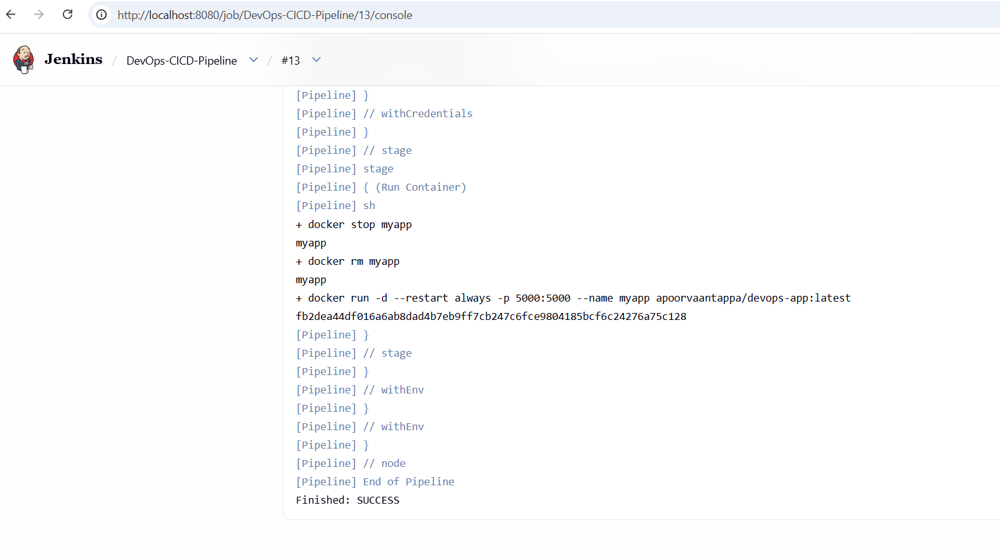
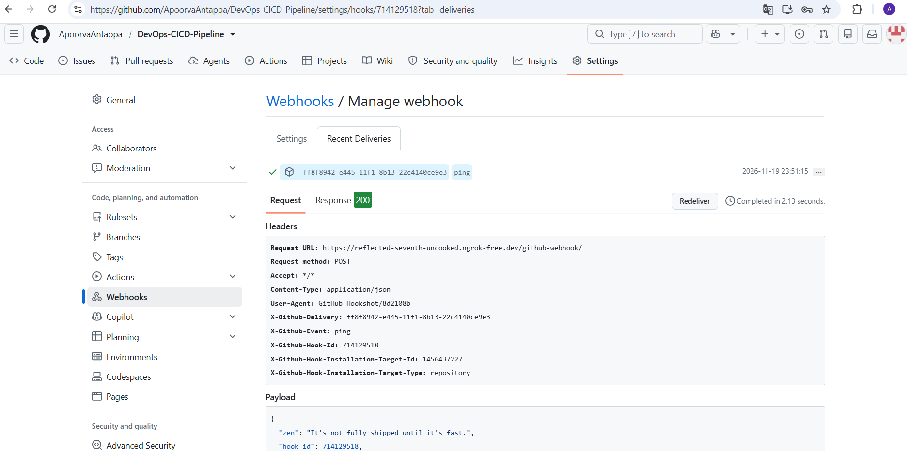
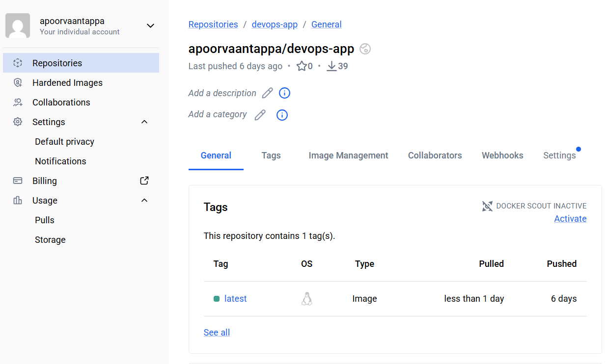
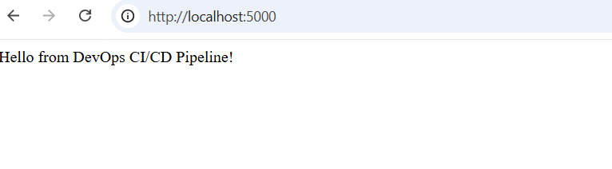
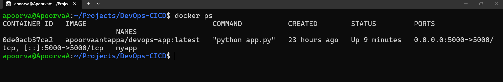

# CI/CD Pipeline Automation using Jenkins, Docker & GitHub

## Project Overview

This project demonstrates an automated CI/CD pipeline that integrates GitHub, Jenkins, Docker, and Docker Hub.

The pipeline automatically builds a Docker image, pushes it to Docker Hub, and deploys the application as a Docker container whenever new code is pushed to GitHub.

---

## Architecture

Developer
|
| Git Push
↓
GitHub Repository
|
| Webhook Trigger
↓
Jenkins Pipeline
|
├── Checkout Source Code
|
├── Build Docker Image
|
├── Login to Docker Hub
|
├── Push Docker Image
|
└── Deploy Docker Container
|
↓
Flask Application
localhost:5000

---

## Technologies Used

- Git & GitHub
- Jenkins
- Docker
- Docker Hub
- Linux
- Shell Scripting
- Flask
- GitHub Webhooks

---

## CI/CD Workflow

### 1. Code Commit

Developer pushes code changes:

git push origin main

### 2. Webhook Trigger

GitHub sends a webhook request to Jenkins.

### 3. Jenkins Pipeline

Pipeline performs:

- Source code checkout
- Docker image creation
- Docker Hub authentication
- Image push
- Container deployment

### 4. Application Deployment

Docker runs the latest application image:

apoorvaantappa/devops-app:latest

Application available at:

http://localhost:5000

---

## Project Structure

DevOps-CICD/
── screenshots/
│   ├── jenkins-success.png
│   ├── github-webhook.png
│   ├── dockerhub-image.png
│   ├── application-running.png
│   └── docker-container.png│
├── docker-app/
│   ├── app.py
│   ├── Dockerfile
│   └── requirements.txt
│
├── Jenkinsfile
└── README.md

---

## Jenkins Pipeline Stages

1. Checkout Source Code
2. Build Docker Image
3. Docker Login and Push
4. Run Container

---

## Docker Commands

Build image:

docker build -t apoorvaantappa/devops-app .

Run container:

docker run -d -p 5000:5000 apoorvaantappa/devops-app

---

## Result

Successfully implemented an automated CI/CD pipeline with:

✅ GitHub integration  
✅ Jenkins automation  
✅ Docker containerization  
✅ Docker Hub publishing  
✅ Automated deployment  

Pipeline Status: SUCCESS
apoorvaantappa/devops-app:latest

Application available at:

http://localhost:5000

---

## Project Structure

DevOps-CICD/
│
├── docker-app/
│   ├── app.py
│   ├── Dockerfile
│   └── requirements.txt
│
├── Jenkinsfile
└── README.md

---

## Jenkins Pipeline Stages

1. Checkout Source Code
2. Build Docker Image
3. Docker Login and Push
4. Run Container

---

## Docker Commands

Build image:

docker build -t apoorvaantappa/devops-app .

Run container:

docker run -d -p 5000:5000 apoorvaantappa/devops-app

---

## Result

Successfully implemented an automated CI/CD pipeline with:

✅ GitHub integration  
✅ Jenkins automation  
✅ Docker containerization  
✅ Docker Hub publishing  
✅ Automated deployment  

Pipeline Status: SUCCESS

---

## Screenshots

### Jenkins Pipeline Success

---

### GitHub Webhook Trigger

---

### Docker Hub Image

---

### Running Application

---

### Docker Container

